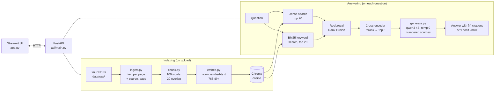

# Local RAG Assistant

Upload your own PDFs, ask questions in plain language, and get answers that **cite the page they came from**. When your documents don't contain the answer, the assistant **says "I don't know"** instead of guessing.

Everything runs locally on a laptop (developed on a Mac M2): no API keys, no cloud, and your documents never leave your machine. The pipeline is built by hand, with no LangChain or LlamaIndex, so every step is visible.

```
Q: What optimizer did the authors use?
A: The authors used the Adam optimizer with β1 = 0.9, β2 = 0.98, and ϵ = 10−9 [1][3].
   [1] attention.pdf, page 7
   [3] attention.pdf, page 11
```

---

## Quick start

**Prerequisites:** Python 3.11 and [Ollama](https://ollama.com).

```bash
# 1. One-time setup
brew install ollama && brew services start ollama
ollama pull qwen3:4b-instruct
ollama pull nomic-embed-text
python3.11 -m venv .venv
.venv/bin/pip install -r requirements.txt
cp .env.example .env

# 2. Start the app (two terminals)
.venv/bin/uvicorn api.main:app        # backend, API docs at http://localhost:8000/docs
.venv/bin/streamlit run app.py        # web UI at http://localhost:8501
```

Then, in the browser:
1. **Upload one or more PDFs** in the sidebar and click **Upload & index**.
2. **Ask a question.** The answer shows `[1]`, `[2]` citations; expand each source to see the exact passage and page.
3. Remove a document with **✕**. The index updates automatically.

**Without the web UI:** copy PDFs into `data/raw/`, build the index with `.venv/bin/python -m src.store`, then ask with `.venv/bin/python -m src.pipeline "your question"`.

---

## Architecture



| Step | File | What it does |
|---|---|---|
| Ingest | [src/ingest.py](src/ingest.py) | Extracts text **page by page**, so every chunk keeps its page number for citations. Removes bibliography markers like `[20]`, which would clash with the app's own `[1]`, `[2]` citations. |
| Chunk | [src/chunk.py](src/chunk.py) | Splits the text into 100-word windows that overlap by 20 words. Chunks never cross pages. |
| Embed | [src/embed.py](src/embed.py) | Turns chunks into vectors with nomic-embed-text, using the `search_document:` / `search_query:` prefixes the model was trained with. |
| Store | [src/store.py](src/store.py) | Chroma vector database with cosine distance. Embeddings are computed outside Chroma. |
| Retrieve | [src/retrieve.py](src/retrieve.py) | `dense`, `hybrid` (dense + BM25, merged with Reciprocal Rank Fusion) or `rerank` (hybrid, then a cross-encoder re-orders the results) |
| Generate | [src/generate.py](src/generate.py) | Sources-only prompt, an exact refusal sentence, temperature 0. Citations that don't point to a real source are removed. |
| Pipeline | [src/pipeline.py](src/pipeline.py) | `ask(question)` returns the answer, the cited sources and every retrieved chunk |

**Stack:** Python 3.11 · Ollama (`qwen3:4b-instruct`, `nomic-embed-text`) · Chroma · PyMuPDF · rank_bm25 · sentence-transformers (`cross-encoder/ms-marco-MiniLM-L-6-v2`) · FastAPI · Streamlit · pytest

---

## Design decisions

These were measured during development on a 50-question test set about *Attention Is All You Need*. "Hit rate" means the passage containing the answer was among the retrieved chunks.

1. **Hybrid search was the biggest improvement.** Adding BM25 keyword search raised the hit rate from **81% to 93%**, and it helped at every chunk size tried. Documents are full of exact terms that embeddings blur, such as `Adam`, `warmup_steps` and `d_model`; BM25 matches them exactly. Reciprocal Rank Fusion merges the two ranked lists by **position only**, because cosine scores (0 to 1) and BM25 scores (0 to about 20) can't be compared directly.
2. **Smaller chunks win, once the comparison is fair.** 400-word chunks first looked perfect (100% hit rate), but 5 chunks of 400 words is 21% of a 15-page paper. With the same ~1,000-word budget for every size, 100-word chunks scored **97.6%** and 400-word chunks **88.1%**.
3. **Reranking improves the ordering.** A cross-encoder reads the question and each passage *together*, so the best passage lands at #1 more often (MRR 0.735 → 0.794). It's too slow to run on every chunk, so it only re-orders the top 20 from hybrid search. The final setup (100-word chunks, rerank, top 5) sends the LLM **half the text** of the alternatives, with a 95% hit rate.
4. **Most wrong answers were retrieval failures, not generation failures.** In the original setup, 7 of 8 wrong answers happened because search missed the right passage. In 6 of those 7, the model correctly said "I don't know" instead of inventing an answer. That's why the improvements targeted retrieval.
5. **Refusing is the generator's job.** Retrieval always returns *something*: "What is the capital of France?" still returned 5 chunks, at a similarity of about 0.51 against about 0.67–0.77 for real matches. A similarity cutoff can't catch near misses, so the prompt requires one exact refusal sentence, which code can detect.
6. **Model choice matters for latency.** The `qwen3:4b` tag always "thinks" first, taking about 90 seconds to say hello. `qwen3:4b-instruct` answers in a few seconds.

## Limitations

- **Text-based PDFs only.** Scanned PDFs contain no text. They're detected and flagged on upload, but OCR isn't implemented.
- **Sentences across a page break are split.** Chunks never cross pages, which keeps citations correct but cuts sentences that continue onto the next page.
- **Every upload re-embeds every document.** That takes seconds for a few papers, but would be slow for hundreds. Incremental indexing is the next step.
- **Small local model.** The 4B model occasionally misreads a passage, or cites only at the end of a multi-sentence answer instead of after every sentence.
- **The reranker was trained on web search,** not on papers, so it occasionally demotes the right passage.

---

## API

| Method | Path | Description |
|---|---|---|
| GET | `/health` | Number of indexed chunks and the active settings |
| POST | `/upload` | Upload PDFs (multipart), save them and re-index; flags scanned PDFs |
| GET | `/documents` | Your documents and their chunk counts |
| DELETE | `/documents/{name}` | Remove a document and re-index |
| POST | `/ask` | `{"question": "...", "k": 5}` → answer, cited sources, all retrieved chunks, time taken |
| POST | `/ingest` | Rebuild the index from `data/raw/` |

Error responses: `400` for a non-PDF upload, `404` for an unknown document, `409` if no documents have been uploaded, `413` for a file over 50 MB, `422` for invalid input, `503` if Ollama isn't running.

Uploads are checked by content (the `%PDF` header), not only by file extension. File names are stripped of folder paths, so an upload can't write outside `data/raw/`.

**Configuration** (in `.env`): `LLM_MODEL`, `EMBED_MODEL`, `CHUNK_SIZE`, `CHUNK_OVERLAP`, `RETRIEVAL_MODE` (`dense` | `hybrid` | `rerank`), `CHROMA_PATH`.

## Project structure

```
├── src/            ingest → chunk → embed → store → retrieve → generate → pipeline
├── api/main.py     FastAPI backend
├── app.py          Streamlit UI
├── tests/          pytest (Ollama and the LLM are mocked); run: .venv/bin/python -m pytest
└── data/raw/       your PDFs (not committed)
```
