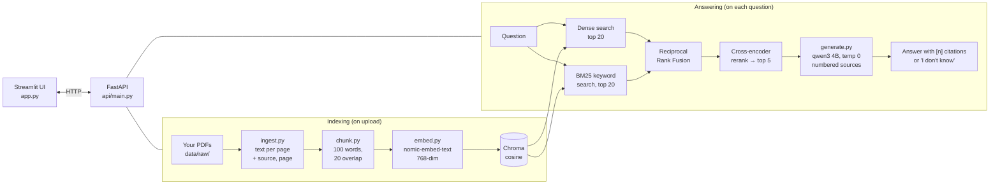

# Local RAG Assistant

Upload your own PDFs, ask questions in plain language, and get answers that **cite the file and page they came from**. If your documents don't contain the answer, the assistant **says "I don't know"** instead of guessing.

Everything runs on your own computer: no API keys, no cloud services, and your documents never leave your machine. The retrieval-augmented generation (RAG) pipeline is written by hand, with no LangChain or LlamaIndex, so every step is visible and easy to follow.

```
Q: What optimizer did the authors use?
A: The authors used the Adam optimizer with β1 = 0.9, β2 = 0.98, and ϵ = 10−9 [1][3].
   [1] attention.pdf, page 7
   [3] attention.pdf, page 11
```

## Features

- **Bring your own documents:** upload one or more PDFs in the browser and remove them again with one click.
- **Cited answers:** every answer carries `[1]`, `[2]` markers, and each source expands to show the exact passage and page.
- **Honest refusals:** when the answer isn't in your documents, it replies *"I don't know based on the provided documents."*
- **Hybrid search with reranking:** keyword search (BM25) and meaning-based search (embeddings) are combined, then a cross-encoder picks the best passages.
- **Runs locally:** a 4-billion-parameter model through [Ollama](https://ollama.com); developed and tested on a MacBook (M2).
- **Web UI and REST API:** a Streamlit interface on top of a FastAPI backend, with an interactive API docs page.

---

## Quick start

**You need:** Python 3.11 and [Ollama](https://ollama.com). The commands below are for macOS with Homebrew; on other systems, install Ollama from its website.

```bash
# 1. Install Ollama and download the two models (~2.8 GB in total)
brew install ollama && brew services start ollama
ollama pull qwen3:4b-instruct
ollama pull nomic-embed-text

# 2. Install the Python dependencies (PyTorch alone is ~1 GB)
python3.11 -m venv .venv
.venv/bin/pip install -r requirements.txt
cp .env.example .env            # optional: the defaults already match .env.example

# 3. Check that Python can reach Ollama
.venv/bin/python -m src.check_ollama

# 4. Start the app: run each command in its own terminal
.venv/bin/uvicorn api.main:app        # backend: http://localhost:8000/docs
.venv/bin/streamlit run app.py        # web UI:  http://localhost:8501
```

### Using the app

1. Open **http://localhost:8501**.
2. In the sidebar, **add one or more PDFs** and click **Upload & index**. Each document takes a few seconds.
3. **Type a question** and click **Ask**. Expand a source to see the exact passage it came from.
4. Remove a document with **✕**. The index updates automatically.

**The first question takes 30–60 seconds**, because the models load into memory and the reranker (about 90 MB) downloads from Hugging Face. That download happens once; after that, answers take roughly 5–15 seconds.

### Command line, without the web UI

```bash
cp ~/papers/*.pdf data/raw/                                    # 1. add PDFs
.venv/bin/python -m src.store                                  # 2. build the index
.venv/bin/python -m src.pipeline "What is the main contribution?"   # 3. ask
.venv/bin/python -m src.retrieve "What is the main contribution?"   # see only which passages are found
```

---

## How it works



| Step | File | What it does |
|---|---|---|
| Ingest | [src/ingest.py](src/ingest.py) | Extracts text **page by page**, so every chunk keeps its page number for citations. Removes bibliography markers such as `[20]` or `[35, 2, 5]`, which would clash with the app's own `[1]`, `[2]` citations. |
| Chunk | [src/chunk.py](src/chunk.py) | Splits each page into 100-word windows that overlap by 20 words, so a sentence on a boundary appears whole in at least one chunk. Chunks never cross pages. |
| Embed | [src/embed.py](src/embed.py) | Turns chunks into 768-number vectors with nomic-embed-text, in batches of 32. Adds the `search_document:` / `search_query:` prefixes the model was trained with. |
| Store | [src/store.py](src/store.py) | Saves chunks, vectors and metadata (file, page) in a local Chroma database, using cosine distance. |
| Retrieve | [src/retrieve.py](src/retrieve.py) | Dense search and BM25 each return their top 20. Reciprocal Rank Fusion merges the two lists, and a cross-encoder re-scores the candidates to keep the best 5. |
| Generate | [src/generate.py](src/generate.py) | Numbered sources go into a prompt that requires citations, allows only facts from the sources, and defines one exact refusal sentence. Temperature 0 makes answers repeatable. |
| Pipeline | [src/pipeline.py](src/pipeline.py) | `ask(question)` returns the answer, the cited sources and every retrieved chunk, after removing any citation that doesn't point to a real source. |

**Stack:** Python 3.11 · Ollama (`qwen3:4b-instruct`, `nomic-embed-text`) · Chroma · PyMuPDF · rank_bm25 · sentence-transformers (`cross-encoder/ms-marco-MiniLM-L-6-v2`) · FastAPI · Streamlit · pytest

---

## Design decisions

The settings were chosen by measurement, not guesswork. During development, each option was tested on a 50-question set about the paper *Attention Is All You Need* (42 answerable questions and 8 deliberately unanswerable ones). That test set isn't included in this repository. **Hit rate** below means the passage containing the answer was among the retrieved chunks.

1. **Hybrid search was the biggest improvement.** Adding BM25 keyword search raised the hit rate from **81% to 93%**, and it helped at every chunk size tried. Technical documents are full of exact terms that embeddings blur, such as `Adam`, `warmup_steps` and `d_model`; BM25 matches them exactly. Reciprocal Rank Fusion merges the two ranked lists by **position only**, because cosine scores (0 to 1) and BM25 scores (0 to about 20) aren't comparable.
2. **Smaller chunks win, once the comparison is fair.** 400-word chunks first looked perfect (100% hit rate), but 5 chunks of 400 words cover 21% of a 15-page paper. With the same ~1,000-word budget for every size, 100-word chunks scored **97.6%**, 200-word chunks 92.9% and 400-word chunks **88.1%**.
3. **Reranking improves the ordering.** A cross-encoder reads the question and each passage *together*, so the best passage lands at #1 more often (MRR, the mean reciprocal rank, rose from 0.735 to 0.794). It's too slow to run on every chunk, so it only re-orders the top candidates. The final setup sends the model **half as much text** as the alternatives, with a 95% hit rate.
4. **Most wrong answers came from retrieval, not generation.** In the original setup, 7 of 8 wrong answers happened because search missed the right passage. In 6 of those 7, the model correctly said "I don't know" instead of inventing an answer. That's why the improvements focused on retrieval.
5. **Refusing is the generator's job.** Search always returns *something*: "What is the capital of France?" still returned 5 chunks, at a similarity of about 0.51 against about 0.67–0.77 for real matches. A similarity cutoff can't catch near misses, so the model decides, and code detects its exact refusal sentence.
6. **Model choice matters for speed.** The `qwen3:4b` tag always "thinks" before answering, taking about 90 seconds to say hello. `qwen3:4b-instruct` answers in a few seconds.

---

## Configuration

Settings are read from `.env`, falling back to the defaults below. After changing `CHUNK_SIZE` or `CHUNK_OVERLAP`, rebuild the index with `.venv/bin/python -m src.store` or the API's `POST /ingest`.

| Variable | Default | Description |
|---|---|---|
| `LLM_MODEL` | `qwen3:4b-instruct` | Ollama model that writes the answers |
| `EMBED_MODEL` | `nomic-embed-text` | Ollama embedding model |
| `RERANK_MODEL` | `cross-encoder/ms-marco-MiniLM-L-6-v2` | Hugging Face cross-encoder used in `rerank` mode |
| `RETRIEVAL_MODE` | `rerank` | `dense` (embeddings only), `hybrid` (+ BM25) or `rerank` (hybrid + cross-encoder) |
| `CHUNK_SIZE` | `100` | Words per chunk |
| `CHUNK_OVERLAP` | `20` | Words shared between neighbouring chunks |
| `CHROMA_PATH` | `data/chroma` | Where the vector database is stored |

## API

Interactive docs are at **http://localhost:8000/docs** while the backend is running.

| Method | Path | Description |
|---|---|---|
| GET | `/health` | Number of indexed chunks and the active settings |
| POST | `/upload` | Upload PDFs (multipart field `files`), save them and re-index; flags PDFs with no text |
| GET | `/documents` | Your documents and their chunk counts |
| DELETE | `/documents/{name}` | Remove a document and re-index |
| POST | `/ask` | `{"question": "...", "k": 5}` → answer, cited sources, all retrieved chunks, time taken |
| POST | `/ingest` | Rebuild the index from the files in `data/raw/` |

```bash
curl -F "files=@paper.pdf" http://localhost:8000/upload
curl -X POST http://localhost:8000/ask -H "Content-Type: application/json" \
     -d '{"question": "What is the main contribution?", "k": 5}'
```

**Validation:** questions must be 3–500 characters, and `k` must be between 1 and 20. Uploads are checked by content (the `%PDF` header), not only by file extension, and are limited to 50 MB. File names are stripped of folder paths, so an upload can't write outside `data/raw/`.

**Error codes:** `400` for a file that isn't a PDF, `404` for an unknown document, `409` when no documents have been uploaded yet, `413` for a file over 50 MB, `422` for invalid input, and `503` when Ollama isn't running.

---

## Development

```bash
.venv/bin/python -m pytest        # 35 tests, a few seconds
```

The tests replace Ollama, the LLM and the reranker with fakes, and use temporary folders. They run without Ollama and never touch your documents or index.

## Troubleshooting

| Problem | Fix |
|---|---|
| "Cannot reach Ollama" / error 503 | Start Ollama with `brew services start ollama`, then run `.venv/bin/python -m src.check_ollama`. |
| "API not reachable" in the web UI | Start the backend first: `.venv/bin/uvicorn api.main:app`. |
| "No text found in …" after uploading | The PDF is scanned (images only). Run OCR on it first, for example with [OCRmyPDF](https://ocrmypdf.readthedocs.io). |
| The first question is very slow | This is normal: the models are loading and the reranker downloads once. Later questions are much faster. |
| Answers are about an old document | After changing the chunk settings or editing `data/raw/` by hand, rebuild the index: `.venv/bin/python -m src.store`. |

## Limitations

- **Text-based PDFs only.** Scanned PDFs are detected and flagged, but OCR isn't built in.
- **Sentences across a page break are split.** Chunks never cross pages, which keeps citations correct but cuts sentences that continue onto the next page.
- **Every change re-indexes every document.** That takes seconds for a few documents, but would be slow for hundreds. Incremental indexing, which embeds only the new file, is the natural next step.
- **Small local model.** The 4B model occasionally misreads a passage, or cites only at the end of a multi-sentence answer instead of after every sentence.
- **General-purpose reranker.** It was trained on web search queries, so on specialised documents it occasionally demotes the right passage.
- **Single user.** There's no login, and uploading while a question is being answered isn't coordinated.

## Project structure

```
├── src/
│   ├── ingest.py         PDF → clean text per page
│   ├── chunk.py          text → overlapping chunks
│   ├── embed.py          chunks → vectors (Ollama)
│   ├── store.py          Chroma database; builds the index
│   ├── retrieve.py       dense, BM25, fusion, reranking
│   ├── generate.py       prompt + LLM call + citation handling
│   ├── pipeline.py       ask(question) → answer + sources
│   └── check_ollama.py   setup check
├── api/main.py           FastAPI backend
├── app.py                Streamlit web UI
├── tests/                pytest suite
├── data/raw/             your PDFs (not committed)
├── .env.example          settings template
└── requirements.txt
```
